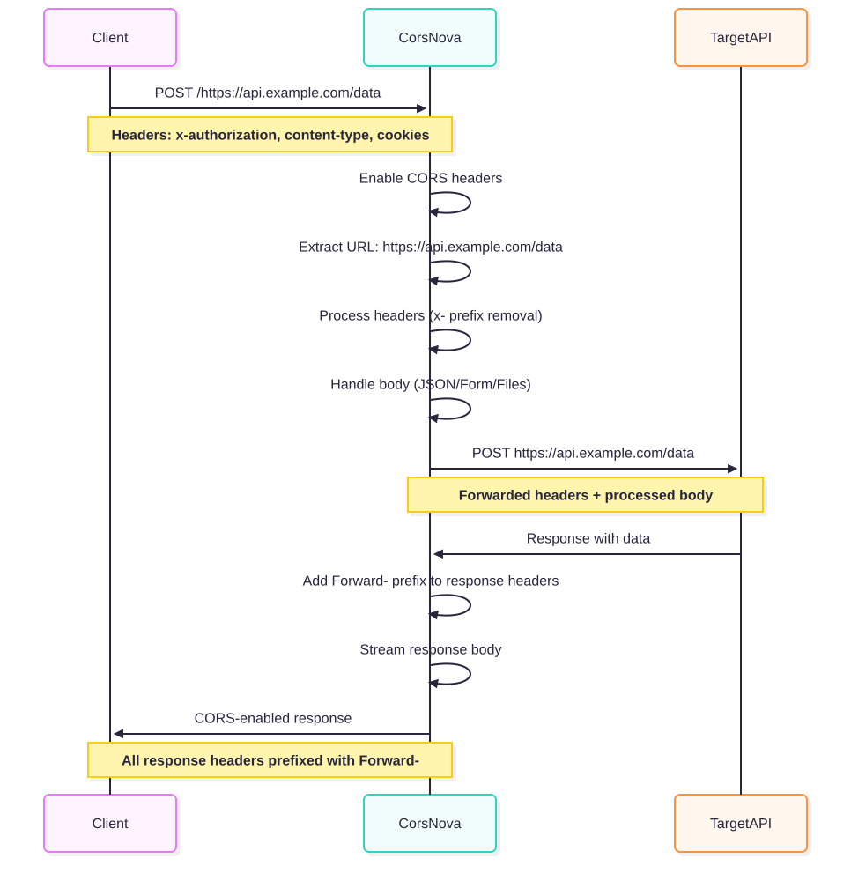

# CorsNova

<p align="center">
  
</p>

A lightweight CORS proxy server built with Express.js. It runs on Cloudflare Workers, can also be deployed to Vercel, Supabase or Docker, and helps bypass CORS restrictions during development and testing.

## Features

- **Universal CORS Proxy**: Forwards requests to any public target URL.
- **SSRF Protection**: Blocks private, loopback, link-local and multicast addresses (including DNS-rebinding attempts).
- **Rate Limiting**: Built-in per-IP token bucket to reduce abuse.
- **Content-Type Support**:
  - `application/json`
  - `application/x-www-form-urlencoded`
  - `multipart/form-data` (file uploads supported)
- **Header Management**:
  - Forwards custom request headers prefixed with `x-` (e.g., `x-authorization` becomes `Authorization`).
  - Forwards cookies from the client to the target server.
  - Forwards all response headers from the target server to the client, prefixed with `Forward-` (e.g., `Content-Type` becomes `Forward-Content-Type`).
  - The upstream `Content-Type` is also set on the response so browsers and HTTP clients can parse the body automatically.
- **Streaming**: Streams responses from the target server back to the client.
- **CDN caching**: Anonymous `GET`/`HEAD` responses are cached on Vercel's CDN for up to 10 minutes, so repeat requests do not invoke the function. See [CDN caching](#cdn-caching).
- **Response size cap**: Responses over 4 MB are refused (configurable with `MAX_RESPONSE_BYTES`).
- **Safe CORS**: Reflects the request `Origin` and sets `Access-Control-Allow-Credentials: true` only when an origin is provided; otherwise it returns `Access-Control-Allow-Origin: *`.

## Requirements

- [Node.js](https://nodejs.org/) 22.x
- A Cloudflare account (or Vercel/Supabase) (for deployment)

## Installation

1. Clone this repository.
2. Run `npm install` in the repository directory.
3. Start the application with `npm run start` or `node app.js`.
4. The server will run on the port specified by the `PORT` environment variable, or `3030` by default.

## Testing

```bash
npm test              # run the full test suite
npm run test:coverage # run tests with coverage
npm run lint          # run ESLint
```

## Usage

Send your request to the CorsNova server, passing the target URL in the `url` query parameter:

```
https://corsnova.artanvrajolli.workers.dev/?url=<target_url>
```

Example:

```
https://corsnova.artanvrajolli.workers.dev/?url=https://example.com/api/data
```

In code, encode the target so its own query string is kept intact:

```javascript
fetch('https://corsnova.artanvrajolli.workers.dev/?url=' + encodeURIComponent('https://example.com/api/data?q=1'));
```

The path form (`https://corsnova.artanvrajolli.workers.dev/https://example.com`) works on Cloudflare Workers, self-hosted and Docker deployments. On Vercel you must use `?url=`: Vercel's edge collapses the `//` into `/` and answers with a `308` redirect that carries no CORS headers, so the browser blocks the request.

### Request Forwarding

- All HTTP methods are supported.
- Request headers prefixed with `x-` are forwarded without the prefix.
- Cookies are forwarded.
- The request body is streamed to the target byte-for-byte, whatever its content type (JSON, URL-encoded, multipart with files, plain text, binary). The limit is 4 MB.
- The default `User-Agent` is `CorsNova/1.0`. Send `x-user-agent` to override it.

### Response Forwarding

- All response headers from the target server are sent back to the client, prefixed with `Forward-`.
- The response body is streamed directly to the client.

## Example

To send a POST request with a custom `Authorization` header and form data to `https://www.example.com`:

```javascript
const formData = new FormData();
formData.append('key1', 'value1');
formData.append('key2', 'value2');
// Append files if needed
// formData.append('myFile', fileInputElement.files[0]);

fetch('https://corsnova.artanvrajolli.workers.dev/?url=' + encodeURIComponent('https://www.example.com'), {
  method: 'POST',
  headers: {
    // Prefix custom headers with 'x-'
    'x-authorization': 'Bearer YOUR_TOKEN_HERE'
  },
  body: formData
})
.then(response => {
  // Access forwarded headers using the 'Forward-' prefix
  console.log('Forwarded Content-Type:', response.headers.get('Forward-Content-Type'));
  return response.json(); // or response.text(), response.blob(), etc.
})
.then(data => {
  console.log('Success:', data);
})
.catch(error => {
  console.error('Error:', error);
});
```

The proxy will make a POST request to `https://www.example.com` with the `Authorization: Bearer YOUR_TOKEN_HERE` header and the provided form data.

## Deployment on Cloudflare Workers

`cloudflare/worker.js` runs the same handler as the Supabase function (`supabase/functions/corsnova/handler.js`) on Cloudflare Workers. Tests are in `test/cloudflare/`.

```bash
cd cloudflare
npx wrangler login
npx wrangler deploy
```

The worker serves from the root of its domain:

```
https://corsnova.<your-subdomain>.workers.dev/?url=<encoded target>
https://corsnova.<your-subdomain>.workers.dev/https://example.com
```

Workers have no DNS API, so the SSRF check resolves each target host over DNS-over-HTTPS (`https://cloudflare-dns.com/dns-query`, A and AAAA records) and blocks private addresses before any upstream request is made.

Optional settings go in the `[vars]` block of `cloudflare/wrangler.toml` (commented out by default; `0` means off):

| Variable | Default |
|---|---|
| `CORSNOVA_TIMEOUT_MS` | `145000` |
| `CORSNOVA_RATE_LIMIT_PER_MINUTE` | `0` |
| `CORSNOVA_MAX_BODY_BYTES` | `0` |

The Workers Free plan allows 10 ms of CPU time per request. Time spent waiting on the network does not count, so plain proxying usually fits, but a request that goes over fails with error 1102 (Worker exceeded resource limits).

## Deployment on Vercel

1. Push the repository to GitHub.
2. Import the project in the [Vercel dashboard](https://vercel.com).
3. Vercel will detect `app.js` as a Node.js 22 serverless function via `vercel.json`.
4. Deploy.

### Vercel-specific limits

- Request/response body size is capped by Vercel (4.5 MB on Hobby by default). The application enforces a 4 MB body limit to match.
- Function execution time is capped by `maxDuration` in `vercel.json` (30 seconds by default).
- Functions run in the regions configured in `vercel.json` (`fra1` and `iad1` by default).
- Every byte a function returns counts as Fast Origin Transfer (function → CDN), and the Hobby plan allows 10 GB. Once that is used up, Vercel pauses the team's deployments. Two settings keep that number down:
  - `MAX_RESPONSE_BYTES` (default 4 MB) caps the size of a proxied response. When the upstream declares a larger `Content-Length`, the proxy cancels the upstream body and answers `502` with a JSON error. A body without `Content-Length` is streamed and cut off once it crosses the cap, so the client sees an incomplete response. `HEAD` requests are not capped. Set `0` to turn the cap off.
  - `CACHE_TTL_SECONDS` (default 600) lets Vercel's CDN serve repeat requests. A CDN hit does not invoke the function and adds no Fast Origin Transfer. Set `0` to turn caching off.

## CDN caching

The proxy sets `Vercel-CDN-Cache-Control: max-age=<ttl>` on a response only when all of these hold:

- The request is `GET` or `HEAD`.
- The request has no `Cookie`, `Authorization` or `Range` header, and no `x-` header apart from platform headers (`x-vercel-*`, `x-forwarded-*`, `x-real-ip`, `x-invocation-id`, `x-matched-path`).
- The upstream status is `200`, `404` or `410`.
- The upstream response has no `Set-Cookie`, no `Vary: *`, and no `no-store`, `no-cache` or `private` in `Cache-Control`.

The TTL is the upstream `s-maxage` (or `max-age` if there is no `s-maxage`), capped at `CACHE_TTL_SECONDS`. Without either directive it is `CACHE_TTL_SECONDS`. An upstream `max-age=0` means no caching.

`Vercel-CDN-Cache-Control` is read only by Vercel's CDN, so browsers and other caches in between are not affected. Cached responses also carry `Vary: Origin, X-Authorization, X-Api-Key, X-Cookie, X-User-Agent`, so each origin gets its own reflected `Access-Control-Allow-Origin`, and requests with different values in those headers never share an entry.

The cache key does not include other custom `x-` headers or `Cookie`. A request that sends one of those is never stored, but it can still be answered with a copy cached by an anonymous request for the same URL. If that matters for a target, add a cache-buster to the target URL (for example `&_=<timestamp>`) or set `CACHE_TTL_SECONDS=0`.

## Deployment on Supabase Edge Functions

`supabase/functions/corsnova/` is the same proxy as a Supabase Edge Function. `handler.js` holds the logic using web-standard APIs only, so `npm test` covers it under Node (`test/supabase/`). `index.ts` wires in Deno's DNS resolver.

```bash
supabase functions deploy corsnova --no-verify-jwt --project-ref <project-ref>
```

`--no-verify-jwt` is required. Without it the gateway rejects every call that lacks a Supabase key. Usage is the same as on Vercel:

```
https://<project-ref>.supabase.co/functions/v1/corsnova?url=<encoded target>
https://<project-ref>.supabase.co/functions/v1/corsnova/https://example.com
```

Differences from the Express version:

- Redirects are followed by hand (up to 20), and every hop goes through the SSRF check. Cross-origin hops drop `Authorization` and `Cookie`.
- No body size cap by default. Bodies up to 4 MB are buffered so 307/308 redirects can resend them. Larger bodies stream straight to the target, and a 307/308 after one is returned to the caller instead of being followed. Uploads of 150 MB went through in testing; the practical ceiling is how much you can upload within Supabase's 150 s limit.
- The 145 s timeout (just under the Free plan's 150 s cutoff) covers the wait for response headers. The body then streams until Supabase's limit.
- `Access-Control-Expose-Headers` lists the `Forward-*` names explicitly, because browsers treat `*` literally on credentialed requests.
- Rate limiting is off by default. When enabled, it keys on `cf-connecting-ip`, which the Supabase gateway sets and clients cannot spoof. It is per worker instance, so it is a best-effort limit.

Supabase platform limits:

- Without a custom domain, a `GET` response with `Content-Type: text/html` is rewritten to `text/plain`. `fetch()` callers still get the same body, and `Forward-Content-Type` carries the real type.
- Supabase appends `(variant; SupabaseEdgeRuntime/…; ref=<project-ref>)` to the outgoing `User-Agent`.
- Ports 25 and 587 are blocked for outbound connections.

Optional function secrets (`0` means off):

| Secret | Default |
|---|---|
| `CORSNOVA_TIMEOUT_MS` | `145000` |
| `CORSNOVA_RATE_LIMIT_PER_MINUTE` | `0` |
| `CORSNOVA_MAX_BODY_BYTES` | `0` |

## Environment variables

| Variable | Default | Description |
|---|---|---|
| `PORT` | `3030` | Local development port. |
| `REQUEST_TIMEOUT_MS` | `25000` | Upstream request timeout in milliseconds. |
| `DEFAULT_USER_AGENT` | `CorsNova/1.0 (...)` | Default `User-Agent` sent to upstream targets. |
| `RATE_LIMIT_PER_MINUTE` | `100` | Maximum requests per IP per minute. |
| `MAX_RESPONSE_BYTES` | `4194304` (4 MB) | Largest upstream response the proxy returns. `0`, negative or invalid turns the cap off. |
| `CACHE_TTL_SECONDS` | `600` | Longest time Vercel's CDN may cache a response. `0` or invalid turns caching off. |
| `VERCEL` | — | Set automatically by Vercel. Prevents `app.listen()` when present. |

## Security notes

- Private IP ranges, loopback addresses, link-local addresses and metadata endpoints are blocked to prevent SSRF.
- Only `http:` and `https:` target URLs are allowed.
- Embedded credentials in target URLs are rejected.
- The proxy is public by default. If you need access control, place it behind an authentication layer or fork and add a shared-secret gate.

## License

MIT License

## Acknowledgments

Inspired by [`allOrigins`](https://github.com/gnuns/allOrigins) by gnuns and [`cors-anywhere`](https://github.com/Rob--W/cors-anywhere) by Rob Wu.
